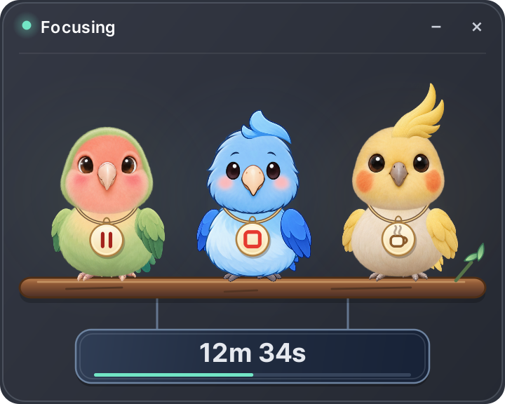

# Reference-preserving parrot animation

The session overlay uses three independently illustrated characters: a peach-faced
lovebird for pause/resume, a blue parrotlet for finish, and a lemon cockatiel for breaks.
The same image rig renders the expanded overlay, collapsed lovebird and opted-in flier.
The original control functions and existing observation/consent defaults are preserved.

## Artwork and movement

Eighteen PNGs ship under `src/focuslab/ui/mascot/art/`: the original nine parts,
expression and fallback images plus nine forward-expression, yaw and pitch atlases.
The original expression sheets remain as source provenance. Each character has five eyelid states plus happy,
wide, singing and concerned expressions. Body, wings, tail, feet and optional tuft are
independently articulated. The lovebird has no invented crest.

The source atlas images are not rewritten. Reviewed rectangles in `manifest.json`
select complete parts, with per-character eye/mouth registration and tuft placement.
Image identity, dimensions and SHA-256 are checked before use. Original source art and
fine feather alpha are preserved; animation preparation occurs in memory using Qt.

A stable neutral head receives feather-edged facial patches using SourceAtop
composition. This preserves its alpha silhouette exactly during blinking and expressions,
instead of changing the whole head's outline with every generated frame. The composed
closed/open-beak variants are cached, not painted or decoded anew for every frame.
An invalid atlas logs a warning and uses that character's original static image so
session controls remain usable. `--check` reports any fallback and returns nonzero.

Existing elapsed-time-driven behaviors control the image rig. A new `greet` behavior
adds a small wing wave. Breathing affects the torso without stretching the eyes or toes;
the separate tuft and tail have secondary sway. Sleep and resume interpolate from the
current behavior pose over 180ms. Minimal movement retains its still-reaction semantics.
At most one random performance (including a planned two-bird interaction) runs at a time.

Five authored yaw views distinguish front, shallow left/right and deeper left/right.
Pitch art adds up, down and each side's preening view. Turned heads have three registered
eyelid states with unchanged alpha silhouettes. Neutral forward expressions replace the
previous permanently angled face. Each actor has an independently seeded gaze sequence,
3–7.5 second dwell times and smoothed movement. Repeated targets are excluded; directions
do not follow a fixed alternating sweep. Attention and explicit behaviors take priority;
minimal movement disables idle gaze. Large idle direction changes are accompanied by a blink.

Wing preening chooses either side and lifts that wing. A per-view beak anchor is solved
onto a point on the rendered feather; two or three irregular strokes follow that contact,
then settle back to the perch. A separate chest-preening behavior uses the down view.
These are brief occasional behaviors with cooldowns, not continuous grooming. The feet
remain fixed through head direction changes and both grooming behaviors.

The overlay requests 16ms updates during gestures, attention transitions and the full
180ms blink. Idle breathing requests 33ms updates; a due blink wakes the faster timer.
Time still comes from the injected monotonic clock, not a frame counter. Hidden and
collapsed views stop their animation timer. A 60Hz presentation is a target, not a
hardware-independent frame-rate or vsync guarantee.

Flight uses the same unfurled wing art, continuous wing rotation, foot tuck and the
existing path, scale and return logic. Flapping amplitude settles during takeoff/landing.
The flier window has space for the larger crest and wings. The expanded perch is 360×288
logical pixels (previously 464×314), with the same bird scale and closer seat spacing.
Session actions are small cream-and-gold necklace pendants, attached to the breathing
torso beneath the head and wings. The cord and pendant follow body motion; keyboard focus
has a visible ring and the unavailable break symbol is muted during a pause. Each whole
parrot remains clickable, with separate nonoverlapping targets. The old button row below
the branch is removed. Chest grooming targets feathers above the necklace. Hover hints
stay below the header. The default resting head is forward-facing; idle gaze is enabled
only in normal/lively motion.

The implementation combines articulated image parts with authored head viewpoints rather
than baking all frame-equivalents into separate PNGs. Rear views, walk cycles and a full
turnaround are not included. Head viewpoints and registered eyelid images are discrete;
additional in-between art remains possible if a future larger display size requires it.

## Source and packaged preview

Run the real overlay with a temporary demo database, no collectors and no camera:

~~~powershell
python -m uv run focuslab --preview-overlay
python -m uv run python scripts/preview_mascots.py --snapshot build/parrots.png --scale 2
python -m uv run python scripts/preview_mascots.py --snapshot build/preen.png --behavior preen --at 2
python -m uv run python scripts/preview_mascots.py --snapshot build/chest.png --behavior preen_chest --at 2
python -m uv run python scripts/preview_mascots.py --snapshot build/sleep.png --state paused
~~~

The packaged equivalent is `FocusLab.exe --preview-overlay`. Its pause/resume, break,
collapse and finish controls operate only on temporary preview data. Close the preview
to exit. Normal use remains `FocusLab.exe`; privacy, startup and extension settings are
not changed by the preview. `FocusLab.exe --check` also verifies packaged character art.

## Validation and delivery

Regression coverage includes original session/flight behavior, species and seat mapping,
blink timing and wakeup, keyboard activation, transitions, art completeness, checksum
failure fallback, unchanged blink silhouettes at every view, distinct directions, feather
contact through grooming strokes, independent idle gaze, minimal motion, wing/crest bounds,
cached rendering and a decoded-raster budget below 48MiB. The locally measured raster cache
is about 28.4MiB;
this excludes Qt window buffers and GPU resources. Whole-app performance depends on the
machine and is not implied by this memory measurement.

PyInstaller's existing collect-data workflow includes the art. The build script additionally
compares every packaged PNG/JSON byte-for-byte with source, alongside its existing
MediaPipe and OpenSSL validations. Copy the entire `dist/FocusLab` folder; the EXE needs
its adjacent `_internal` directory.

Windows system DLLs are resolved before unrelated PATH tools. A post-merge EXE check
found that a Poppler ICU 78 DLL could shadow the Windows ICU API required by QtCore,
even though source tests and the wheel passed. The build now prioritizes System32 and
rejects a foreign bundled icuuc.dll. Windows CI builds the actual EXE and runs
`--check-report build/packaged-check.txt` with a bounded wait. The report includes the
loaded Qt runtime and character validation; failures return nonzero without blocking
on PyInstaller's windowed exception dialog. This recovery does not modify Windows DLLs.

Delivery surfaces: GitHub source and a rebuilt desktop EXE. There is no browser extension
or Native Messaging protocol change. A main merge does not update an existing binary;
EXE replacement and actual Windows verification must be recorded separately. This feature
does not bump the release version, publish a tag or create a GitHub Release. A local main
build is distinguished by its commit in Settings > Updates and `focuslab/_build.json`.

## Provenance

Created with the built-in ImageGen tool on 2026-11-03, using the three character concepts
selected in this chat as identity references. Full production prompts are recorded in
[art/prompts.json](../src/focuslab/ui/mascot/art/prompts.json). No external artwork or new
third-party runtime dependency was introduced. The original reference cutouts serve as
the fallback files; generated atlases are bundled without file-level image edits.
Directional and new forward-expression prompts are recorded in
[head-view-prompts.json](../src/focuslab/ui/mascot/art/head-view-prompts.json).
